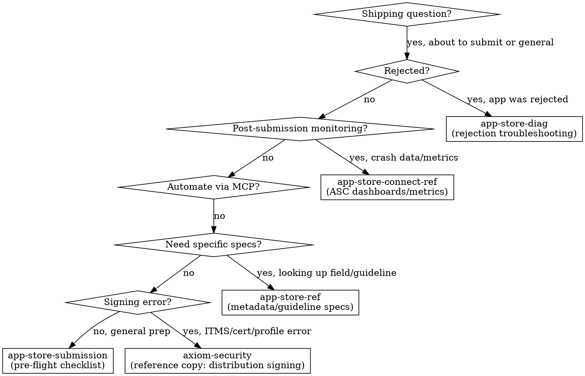

# Shipping & App Store

**You MUST use this skill when preparing to submit ANY app, handling App Store rejections, or working on release workflow.**

> Vendoring note: this is a trimmed copy of Axiom's `axiom-shipping` router. Upstream it depends on Axiom agents (`security-privacy-scanner`, `iap-auditor`, `screenshot-validator`, `triage-analyzer`), slash commands (`/axiom:audit`, `/axiom:triage`, `/axiom:analyze-crash`), bundled binaries (`xcsym`, `xclog`, `xcprof`), hooks, and sibling suites. None of those exist in this repo. Where upstream launched an agent, do the work yourself with the sub-doc named; where it pointed at another Axiom suite, see "Sibling suites" at the end. The sub-docs under `skills/` are copied unmodified and still mention those tools; treat such mentions as "do this by hand".

## When to Use

Use this skill when you encounter:
- Preparing an app for App Store submission
- App Store rejection (any guideline)
- Metadata requirements (screenshots, descriptions, keywords)
- Privacy manifest and nutrition label questions
- Age rating and content classification
- Export compliance and encryption declarations
- EU DSA trader status
- Account deletion or Sign in with Apple requirements
- Build upload and processing issues
- App Review appeals
- WWDC25/WWDC26 App Store Connect changes
- First-time submission workflow

## Quick Reference

| Symptom / Task | Reference |
|----------------|-----------|
| How do I submit my app? | See `skills/app-store-submission.md` |
| Pre-flight checklist | See `skills/app-store-submission.md` |
| First-time submission | See `skills/app-store-submission.md` |
| Encryption compliance | See `skills/app-store-submission.md` |
| Accessibility Nutrition Labels | See `skills/app-store-submission.md` |
| Metadata field requirements | See `skills/app-store-ref.md` |
| Product Page Header, Asset Library, search visuals `OS27` | See `skills/app-store-ref.md` (Part 11) |
| Retention Messaging (subscription cancellation flow) `OS27` | See `skills/app-store-ref.md` (Part 11) |
| Group / volume subscription selling (ABM, ASM, volume pricing) `OS27` | See `skills/app-store-ref.md` (Part 11) |
| Guideline number lookup | See `skills/app-store-ref.md` |
| Privacy manifest schema | See `skills/app-store-ref.md` |
| Age rating tiers | See `skills/app-store-ref.md` |
| EU DSA compliance | See `skills/app-store-ref.md` |
| WWDC25/WWDC26 ASC changes | See `skills/app-store-ref.md` |
| App was rejected | See `skills/app-store-diag.md` |
| Guideline 2.1/4.2/4.3 rejection | See `skills/app-store-diag.md` |
| Writing an appeal | See `skills/app-store-diag.md` |
| Repeated rejections | See `skills/app-store-diag.md` |
| App Review Guidelines reference | See `skills/app-review-guidelines.md` |
| Expert review checklist | See `skills/expert-review-checklist.md` |
| Crash data in App Store Connect | See `skills/app-store-connect-ref.md` |
| TestFlight crash reports | See `skills/app-store-connect-ref.md` |
| ASC metrics dashboards | See `skills/app-store-connect-ref.md` |
| Privacy/security code scan, IAP audit, screenshot validation | Upstream agents, not available here; see sections 4–6 for the manual version |
| ITMS signing error on upload, certificate/profile mismatch, code signing setup | Reference copy of `axiom-security` (`skills/code-signing-diag.md`, `skills/code-signing.md`); see "Sibling suites" |
| Crash triage (TestFlight, Organizer, Sentry/ASC corpora), App Clips | Cut from this router; sub-docs kept, see "Removed routes" |

## Routing Logic

### 1. Pre-Submission Preparation → **app-store-submission**

**Triggers**:
- "How do I submit my app?"
- "What do I need before submitting?"
- Preparing for first submission
- Pre-flight checklist needed
- Screenshot requirements
- Metadata completeness check
- Encryption compliance questions
- Accessibility Nutrition Labels
- Privacy manifest requirements for submission

**Why app-store-submission**: Discipline skill with 8 anti-patterns, decision trees, and pressure scenarios. Prevents the mistakes that cause 90% of rejections.

**Reference**: `skills/app-store-submission.md`

---

### 2. Metadata, Guidelines, and API Reference → **app-store-ref**

**Triggers**:
- "What fields are required in App Store Connect?"
- "What's the max length for app description?"
- Specific guideline number lookup
- Privacy manifest schema details
- Age rating tiers and questionnaire
- IAP submission metadata
- EU DSA compliance details
- Build upload methods
- WWDC25 and WWDC26 changes to App Store Connect

**Why app-store-ref**: 11-part reference covering every metadata field, guideline, and compliance requirement with exact specifications.

**Reference**: `skills/app-store-ref.md`

---

### 3. Rejection Troubleshooting → **app-store-diag**

**Triggers**:
- "My app was rejected"
- "Guideline 2.1 rejection"
- "Binary was rejected"
- Guideline 4.2 or 4.3 rejection (app too simple, web wrapper, spam, duplicate)
- Guideline 1.x rejection (objectionable content, UGC moderation, Kids category)
- How to respond to a rejection
- Writing an appeal
- Understanding rejection messages
- Third or repeated rejection
- Resolution Center communication

**Why app-store-diag**: 9 diagnostic patterns mapping rejection types to root causes and fixes, including subjective rejections (4.2/4.3, 1.x). Includes appeal writing guidance and crisis scenario for repeated rejections.

**Reference**: `skills/app-store-diag.md`

---

### 4. Privacy & Security Compliance (manual; upstream used the `security-privacy-scanner` agent)

**Triggers**:
- "Scan my code for privacy issues before submission"
- Hardcoded API keys or secrets
- Missing privacy manifest
- Required Reason API declarations
- ATS violations

**What to do here**: the agent and `/axiom:audit security` are not available. Use the installed `privacy-manifests` skill (`.claude/skills/privacy-manifests/`) for Required Reason API and manifest work, and the reference copy of `axiom-security` (see "Sibling suites") for ATS and secrets patterns. Grep the project yourself for hardcoded keys, `NSAllowsArbitraryLoads`, and a missing `PrivacyInfo.xcprivacy`.

---

### 5. IAP Review Issues (manual; upstream used the `iap-auditor` agent)

**Triggers**:
- IAP rejected or not working
- Missing transaction.finish()
- Missing restore purchases
- Subscription tracking issues

**What to do here**: check by hand that every transaction is finished, that a working Restore Purchases control exists, and that subscription terms are visible before purchase. `skills/app-store-diag.md` has the StoreKit rejection patterns.

---

### 6. Screenshot Validation (manual; upstream used the `screenshot-validator` agent)

**Triggers**:
- "Check my App Store screenshots"
- "Are my screenshots the right dimensions?"
- "Validate screenshots before submission"
- Screenshot content or dimension questions

**What to do here**: open each screenshot with the Read tool, check its pixel dimensions against the size table in `skills/app-store-ref.md`, and look for placeholder text, debug overlays, broken UI, and competitor references.

---

### 7. Programmatic ASC Access → **asc-mcp**

**Triggers**:
- "Automate App Store Connect"
- "Submit build programmatically"
- "Manage TestFlight from Claude"
- "Respond to reviews via API"
- "Set up asc-mcp"
- "Distribute to TestFlight groups via MCP"
- "Create a new version without opening ASC"

**Why asc-mcp**: Workflow-focused skill teaching Claude to use asc-mcp MCP tools for release pipelines, TestFlight distribution, review management, and feedback triage — all without leaving Claude Code.

---

### 8. Post-Submission Monitoring → **app-store-connect-ref**

**Triggers**:
- "How do I view crash data in App Store Connect?"
- "Where are my TestFlight crash reports?"
- "How do I read ASC metrics dashboards?"
- Post-release crash investigation
- Downloading crash logs from ASC

**Why app-store-connect-ref**: ASC navigation for crash dashboards, TestFlight feedback, performance metrics, and data export workflows.

**Reference**: `skills/app-store-connect-ref.md`

---

## Decision Tree

Simplified:

1. App was rejected? → `skills/app-store-diag.md`
2. Post-submission crash data/metrics? → `skills/app-store-connect-ref.md`
4. Need specific metadata/guideline specs? → `skills/app-store-ref.md`
5. IAP submission issue? → `skills/app-store-diag.md` plus the manual check in section 5
6. Pre-submission privacy/security scan? → installed `privacy-manifests` skill plus the `axiom-security` reference copy (section 4)
7. ITMS signing/certificate/profile error on upload? → `axiom-security` reference copy, `skills/code-signing-diag.md`
8. General submission preparation? → `skills/app-store-submission.md`

## Anti-Rationalization

| Thought | Reality |
|---------|---------|
| "I'll just submit and see what happens" | 40% of rejections are Guideline 2.1 (completeness). app-store-submission catches them in 10 min. |
| "I've submitted apps before, I know the process" | Requirements change yearly. Privacy manifests, age rating tiers, EU DSA, Accessibility Nutrition Labels are all new since 2024. |
| "The rejection is wrong, I'll just resubmit" | Resubmitting without changes wastes 24-48 hours per cycle. app-store-diag finds the root cause. |
| "Privacy manifests are only for big apps" | Every app using Required Reason APIs needs a manifest since May 2024. Missing = automatic rejection. |
| "I'll add the metadata later" | Missing metadata blocks submission entirely. app-store-ref has the complete field list. |
| "It's just a bug fix, I don't need a full checklist" | Bug fix updates still need What's New text, correct screenshots, and valid build. app-store-submission covers it. |
| "I'll just eyeball the screenshots myself" | Human review misses dimension mismatches (even 1px off = rejection), subtle placeholder text, and debug indicators. Check every screenshot against the size table in `skills/app-store-ref.md` before upload. |
| "Upload failed with ITMS error, let me re-archive" | ITMS signing errors are configuration — wrong cert, expired profile, missing entitlement. Re-archiving with the same config produces the same result. The `axiom-security` reference copy (`skills/code-signing-diag.md`) has the fix. |

## When NOT to Use (Conflict Resolution)

**Do NOT use axiom-shipping for these — use the correct skill instead:**

| Issue | Correct Skill | Why NOT axiom-shipping |
|-------|---------------|----------------------|
| Build fails before archiving | `axiom-build` (reference copy, see "Sibling suites") | Environment/build issue, not submission |
| SwiftData migration crash | `axiom-data` (not vendored) | Schema issue, not App Store |
| Privacy manifest coding (writing the file) | installed `privacy-manifests` skill | This router covers submission, not writing the manifest |
| StoreKit 2 implementation (writing IAP code) | `axiom-integration` (not vendored) | in-app-purchases / storekit-ref covers implementation |
| Performance issues found during testing | `axiom-performance` (not vendored) | Profiling issue, not submission |
| Accessibility implementation | installed `accessibility-audit` skill; `axiom-accessibility` reference copy | Code-level accessibility, not App Store labels |

**axiom-shipping is for the submission workflow**, not code implementation:
- Preparing metadata and compliance → axiom-shipping
- Writing the actual code → domain-specific skill
- App was rejected → axiom-shipping
- Code changes to fix rejection → domain-specific skill, then back to axiom-shipping to verify

## Example Invocations

User: "How do I submit my app to the App Store?"
→ See `skills/app-store-submission.md`

User: "My app was rejected for Guideline 2.1"
→ See `skills/app-store-diag.md`

User: "What screenshots do I need?"
→ See `skills/app-store-ref.md`

User: "What fields are required in App Store Connect?"
→ See `skills/app-store-ref.md`

User: "How do I fill out the age rating questionnaire?"
→ See `skills/app-store-ref.md`

User: "Do I need an encryption compliance declaration?"
→ See `skills/app-store-submission.md`

User: "My app keeps getting rejected, what do I do?"
→ See `skills/app-store-diag.md`

User: "How do I appeal an App Store rejection?"
→ See `skills/app-store-diag.md`

User: "My app was rejected for Guideline 4.2 minimum functionality"
→ See `skills/app-store-diag.md`

User: "Rejected for being a web wrapper / duplicate app"
→ See `skills/app-store-diag.md`

User: "Rejection for user-generated content without moderation"
→ See `skills/app-store-diag.md`

User: "Kids category compliance rejection"
→ See `skills/app-store-diag.md`

User: "Scan my code for App Store compliance issues"
→ Section 4 (manual scan) plus the installed `privacy-manifests` skill

User: "Check my IAP implementation before submission"
→ Section 5 (manual check) plus `skills/app-store-diag.md`

User: "Are my screenshots the right dimensions?"
→ Section 6 (manual check) against `skills/app-store-ref.md`

User: "How do I find crash data in App Store Connect?"
→ See `skills/app-store-connect-ref.md`

User: "Where are my TestFlight crash reports in ASC?"
→ See `skills/app-store-connect-ref.md`

User: "What's new in App Store Connect this year?"
→ See `skills/app-store-ref.md`

User: "I need to set up DSA trader status for the EU"
→ See `skills/app-store-ref.md`

User: "What are Accessibility Nutrition Labels?"
→ See `skills/app-store-submission.md`

User: "This is my first app submission ever"
→ See `skills/app-store-submission.md`

User: "Submit this build to App Store programmatically"

User: "ITMS-90035 Invalid Signature when uploading"
→ `axiom-security` reference copy, `skills/code-signing-diag.md`

## Removed routes

Cut from this copy of the router to stay under 400 lines and drop tool dependencies; the sub-docs remain in `skills/` for reference:

- **Agent-backed routes**: `security-privacy-scanner`, `iap-auditor`, `screenshot-validator`, `triage-analyzer` (procedures replaced by the manual sections 4–6 above).
- **Claude API model-migration guidance** (the external `claude-api` skill and the "4.6 → 4.7" rows): unrelated to this project.
- **watchOS submission pointer** (`axiom-watchos`): suite not vendored.
- **Bundled-tools preamble and the auto-maintained `AXIOM_AUDITOR_INLINE` block**: refer to plugin binaries and MCP tools that are not present.

## Sibling suites

| Upstream suite | Status here |
|---|---|
| `axiom-security` (code-signing.md, code-signing-diag.md, security-privacy-scanner procedure) | Reference-only copy: `.atlas/knowledge/vendor/CharlesWiltgen-Axiom/.claude-plugin/plugins/axiom/skills/axiom-security/` |
| `axiom-build` | Reference-only copy: `.atlas/knowledge/vendor/CharlesWiltgen-Axiom/.claude-plugin/plugins/axiom/skills/axiom-build/` |
| `axiom-accessibility` | Reference-only copy: `.atlas/knowledge/vendor/CharlesWiltgen-Axiom/.claude-plugin/plugins/axiom/skills/axiom-accessibility/` |
| `axiom-tools` (xcsym-ref), `axiom-integration` (iap-auditor, storekit-ref), `axiom-payments`, `axiom-watchos`, `axiom-data`, `axiom-performance` | Not vendored |
